# WIIZARD

Softmodded Wiis as garage arcade cabinets on CRTs. Each cabinet is an original Wii (RVL-001, GameCube ports) on a
consumer CRT over component video, booting straight into WIIZARD, our own launcher: an attract mode that plays
gameplay clips, a browse menu with collections, and one-button starts for arcade sets, console classics, GameCube
discs and Wii games. Nobody touches a Wii Menu, a settings screen or a Wii Remote. The cabinets are run from a Mac,
hands-free, by Claude through an MCP server and a small remote agent built into the launcher.

<p align="center">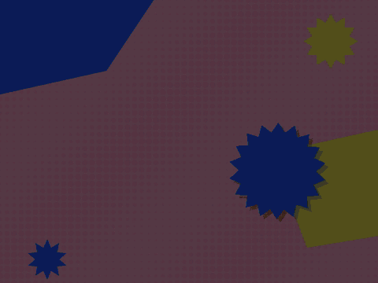</p>

<p align="center"><b><a href="https://github.com/hotdog-face/wiizard/releases/download/v0.11-media/WIIZARD-reel.mp4">Watch the reel (85 s)</a></b> &middot;
<a href="https://github.com/hotdog-face/wiizard/releases/tag/v0.11-media">1080p screen recordings</a> &middot; <a href="#gallery">Gallery</a></p>

The wizard is my own character (from a 2017 drawing), cut out of the original PSD and puppeted for the power-on
intro: pop-in with squash and stretch, a blink, the Wii Remote flicked up like a wand, a wink, an idle bob.

<table>
<tr>
<td width="50%">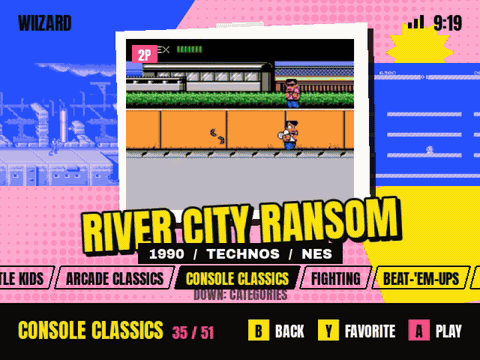<br><sub>The menu: carousel, sections, the favourite heart</sub></td>
<td width="50%">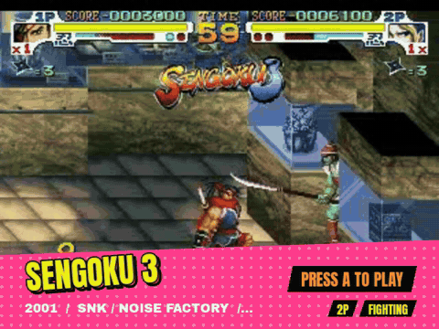<br><sub>Attract mode: a game's own demo on a taped photo, PRESS A TO PLAY</sub></td>
</tr>
</table>

## Gallery

All launcher footage is the real launcher build on a real card's contents, recorded in our headless Dolphin
simulator with scripted pad input (so every take is smooth), plus framebuffer screenshots from the cabinet itself.
Loops are also here as small MP4s: [intro](docs/media/loop-intro.mp4), [menu](docs/media/loop-menu.mp4),
[attract](docs/media/loop-attract.mp4). Full-length 1080p recordings (clean and with a CRT treatment), including
launching games and coming back, are on the [v0.11-media release](https://github.com/hotdog-face/wiizard/releases/tag/v0.11-media).

| | |
|---|---|
| 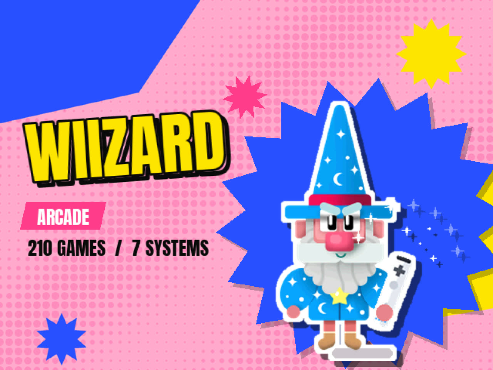 | 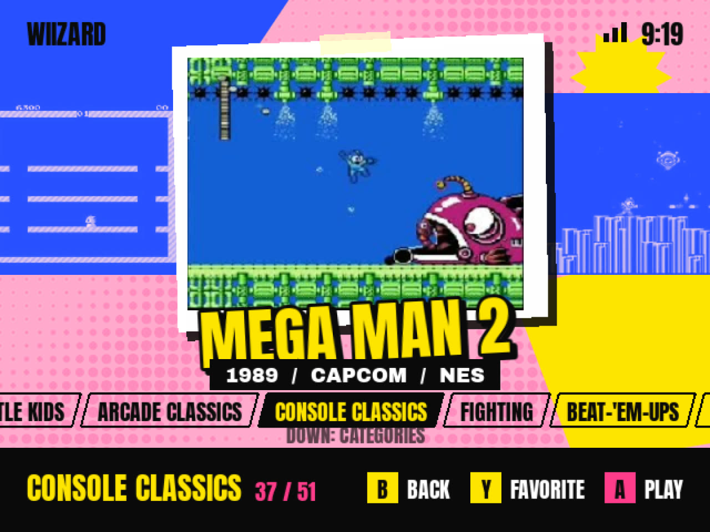 |
| **Intro**: the wizard, the WIIZARD slam, games and systems counted | **Menu**: the selected game's clip on a taped photo, neighbours as blue duotones |
|  | 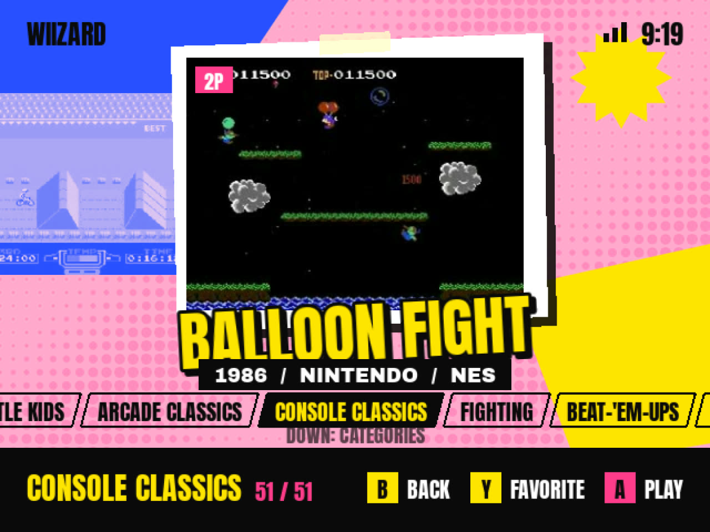 |
| **Favourites**: Y hearts a game | **Sections**: L / R through the collections |
| 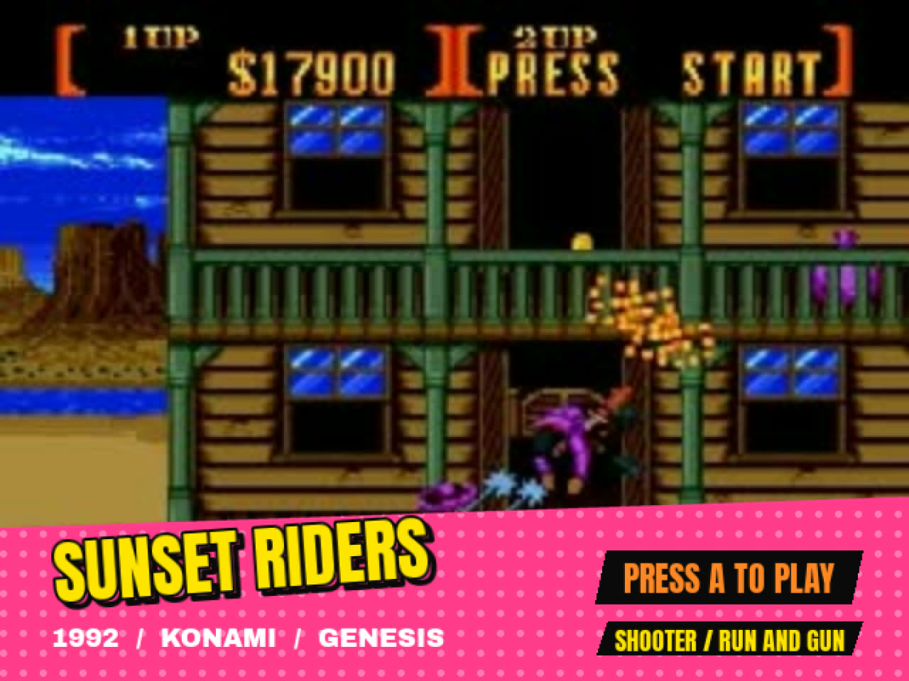 | 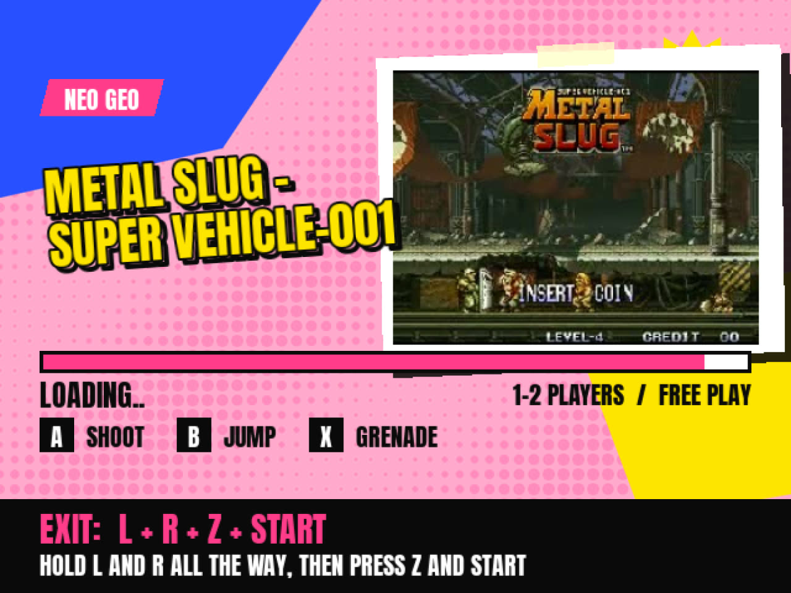 |
| **Attract mode** | **Loading**: the controls and the one exit combo, before every game |
| 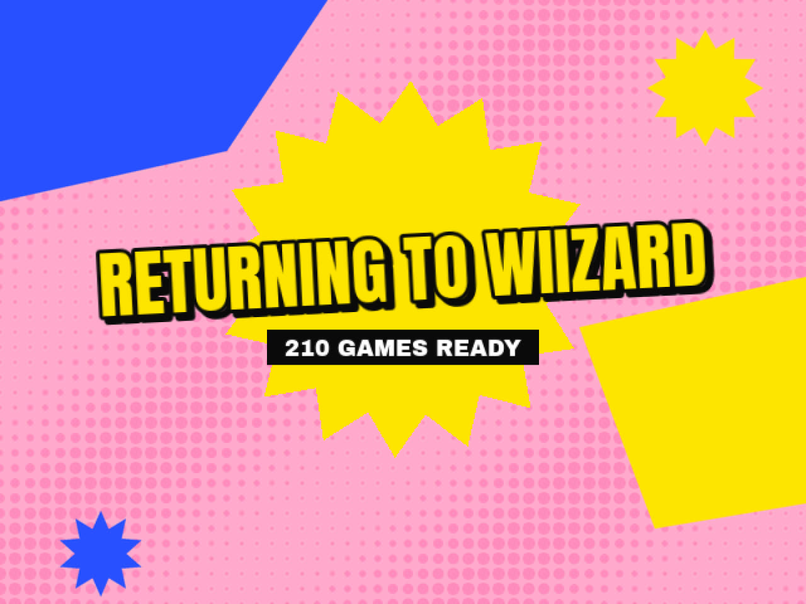 | 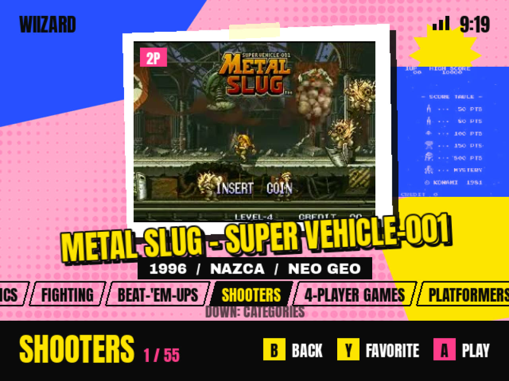 |
| **Back from a game**, straight into the launcher | **Shooters**, one of the play-count-ordered collections |

### How it was made


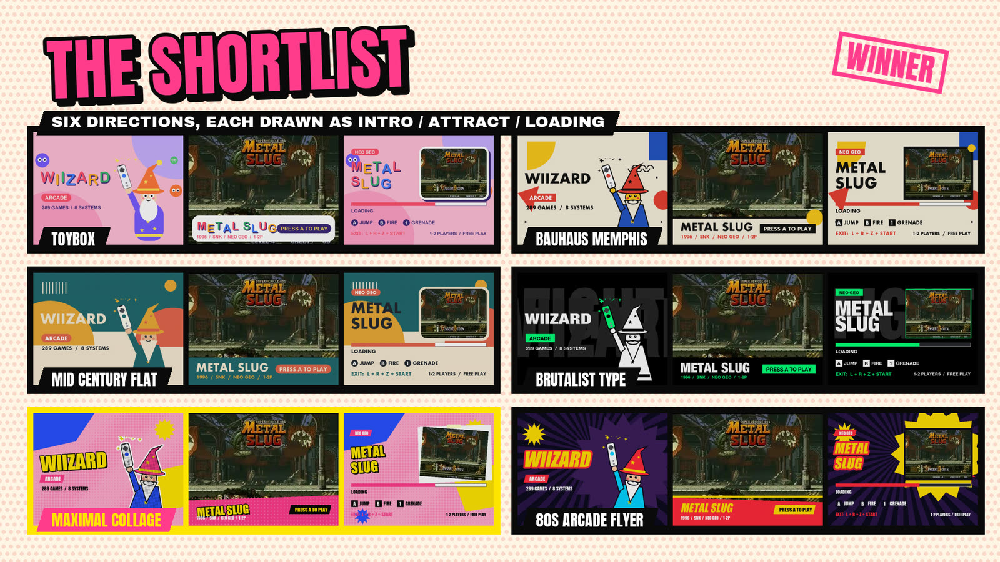
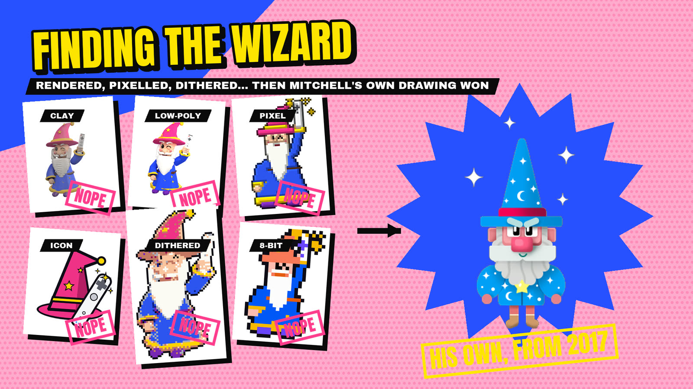
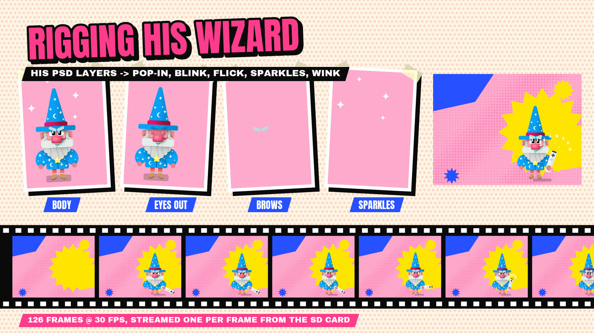
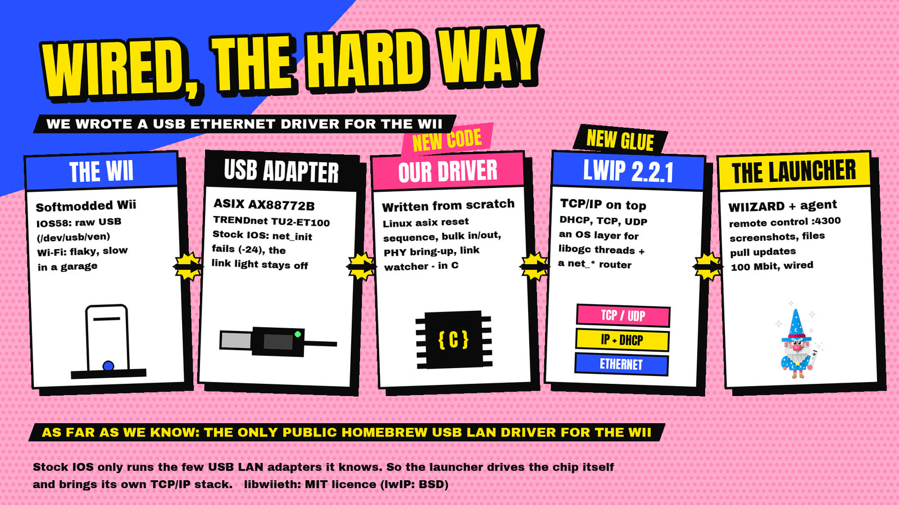
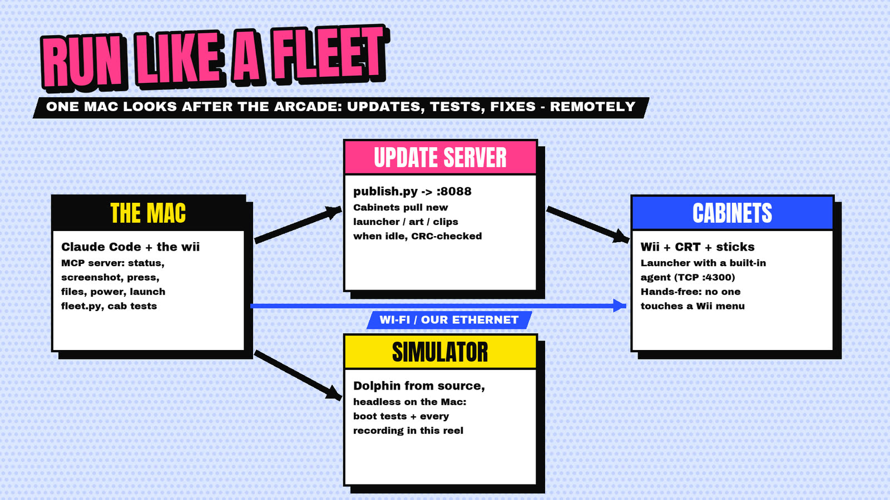
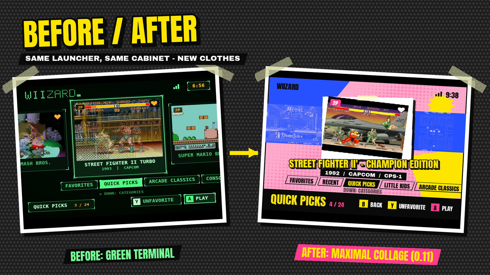

<table>
<tr>
<td width="50%">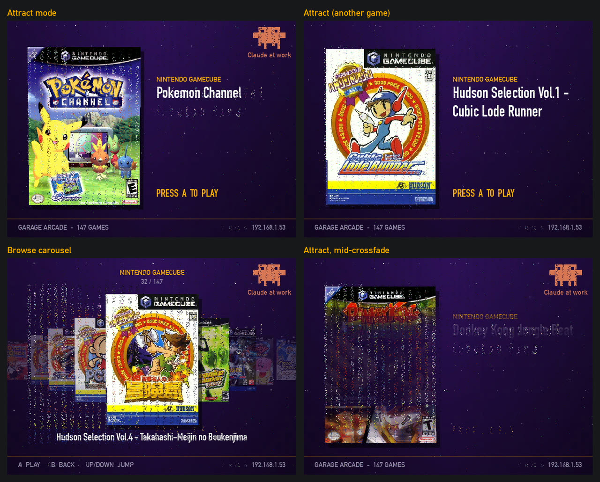<br><sub>0.3: the first launcher</sub></td>
<td width="50%">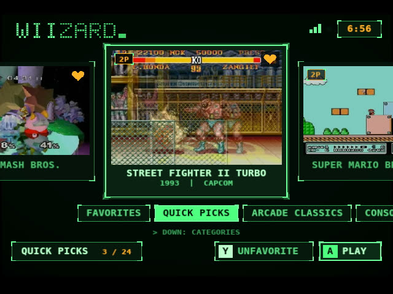<br><sub>Before 0.11: the green terminal look</sub></td>
</tr>
</table>

## What's in here

| Path | What |
|---|---|
| `agent/` | **The launcher** (C, libogc, devkitPPC): menu, attract mode, game launching, the remote agent (TCP 4300), pull updates, our USB Ethernet driver, disc drive commands, a GX renderer |
| `hop/` | The tiny start-up program Priiloader runs from NAND; it picks the launcher, the last good launcher, or the Homebrew Channel |
| `wii_mcp.py`, `wiiagent.py`, `wiiload.py` | The MCP server (stdio JSON-RPC) and the agent protocol client |
| `fleet.py`, `publish.py`, `cab_queue.py`, `queue_run.py`, `cab_test.py` | Fleet collection and health report, the update server publisher, unattended boot tests |
| `sdkit_install.py`, `sd_backup.py`, `romcheck.py`, `new_wii.py`, `sdkit/` | Building a cabinet's SD card, backing one up, picking arcade sets that run, turning a new Wii into a cabinet |
| `cios/` | Builds and installs a d2x cIOS 249 remotely, from the console's own base IOS (no NUS, no hands on the console) |
| `nintendont/`, `retroarch/`, `sim/dolphin-wiisim.patch` | Our patches against Nintendont, RetroArch + libretro cores, and Dolphin, as patch files |
| `sim/` | Running the launcher in Dolphin (headless, on the Mac or in Docker) to check screens and boot games without a console |
| `videos/` | The media pipeline: gameplay clips, stills, audio, metadata, bezels, per-game RetroArch video overrides (`av_fix/`) |
| `art/` | Art direction: twenty explored looks, the shortlist, the chosen "maximal collage", the wizard parts and animation, `make_ui.py` (pre-renders the UI art) |
| `NEW_WII.md` | New Wii -> cabinet, start to finish (owner steps vs remote steps) |

The USB Ethernet driver lives on as its own library: **[libwiieth](https://github.com/hotdog-face/libwiieth)**.

Not in here, on purpose: games, ROMs, disc images, the launcher's gameplay clips, stills, box art, flyers and marquees
(all copyrighted by their owners; the scripts that make them are here, the media isn't), built DOLs, third-party
sources (linked below), console NAND backups, keys, and anything about my own network. The recordings in
`docs/media/` show the launcher's interface; games appear only as they do inside it, briefly.

## How it works

### Boot chain

```
power on -> Priiloader (NAND, AHBPROT kept) -> hop (NAND main.bin) -> sd:/apps/wii-agent/boot.dol (WIIZARD)
                                                  |  2 failed starts -> boot-good.dol (the last version that ran well)
                                                  |  5 failed starts -> the Homebrew Channel
```

- Games go back to WIIZARD directly: crashes, `exit()` and "return to loader" go through the HBC reload stub at
  0x80001800, which the launcher retargets to the System Menu, so they land in Priiloader -> hop -> launcher, never in
  the HBC. Our RetroArch build execs the launcher itself and skips the round trip.
- The launcher keeps AHBPROT across its own IOS reloads (Priiloader's ES patch), so Nintendont and USB Loader GX get it.
- Boot-loop guard: three starts that never reach 60 s and the next start is SAFE MODE (text-only agent, no UI), so the
  Mac can always fix things.

### The launcher (`agent/`)

- **One program**: the arcade front end and the remote agent are the same DOL.
- **Direct game boot for every system.** GameCube -> Nintendont with its config block as argv and auto-boot; Wii ->
  USB Loader GX `-sdmode=1 <GAMEID>`; arcade and consoles -> RetroArch with the core linked in, ROM folder and file
  as argv. A game that doesn't come back within 45 s is retried once, then "Couldn't start this game"; one that fails
  on two occasions is hidden automatically and shows up in the fleet report.
- **Own renderer.** SDL2's Wii renderer corrupted geometry and crashed after the first frame, so drawing is our own
  GX code (`gfx.c`: polygons, stars, textured quads, a duotone TEV stage, streamed RGB5A3 animation frames); SDL is
  only used to decode PNGs and rasterise fonts. The menu runs at 59.7 fps.
- **Kid-proof.** Buttons do nothing for 0.8 s after a screen change, Reset and HOME go back to attract mode, never
  out of the launcher; one exit combo for every arcade and GameCube game (L + R + Z + START), shown on the loading
  screen; idle power-off after a quiet stretch in attract mode.
- **CRT calibration** per cabinet (width, height, x, y) with a white edge frame, set remotely.
- **Card writes are whole-file swaps**; the log lives in RAM and reaches the card every 10 minutes and before every
  game.

### Remote control (`wii_mcp.py`, the agent)

The agent listens on TCP 4300 inside the launcher: files on `sd:/` and `usb:/` (resumable chunked uploads),
screenshots of the front framebuffer, virtual buttons, EXEC, NAND reads, a short allow-list of NAND writes
(Priiloader's boot file, its flags, autoboot, SYSCONF's screen settings), calibration and power. `wii_mcp.py` wraps it
as MCP tools (`status`, `screenshot`, `press`, `play`, `files_*`, `start_agent`, `screen`, `power`, ...), and the
Homebrew Channel's wiiload (TCP 4299) is the fallback for getting the agent onto a Wii in the first place.

```bash
claude mcp add --scope user wii -- python3 /path/to/wiizard/wii_mcp.py
```

The agent has no authentication: it's meant for a home LAN only. Don't forward port 4300.

Wi-Fi on these consoles is flaky, so the agent works around it: it retries and relaunches itself on a fresh IOS
after three failed `net_init`s, sends a UDP heartbeat every 3 s (without outbound traffic the Wi-Fi went deaf after
autoboot), checks the router every 20 s when idle, and drops clients that go silent for 20 s.

### The Ethernet driver story


The first cabinet sits next to the router, so it should have been on a cable. It wasn't that easy: its USB LAN
adapter (a TRENDnet TU2-ET100, ASIX AX88772B) isn't one IOS knows. `net_init` failed with -24 and the adapter's
link light never even came on, because IOS never powers up the chip's PHY. Switching IOS's own connection to wired
made it worse: that disables Wi-Fi and still can't run the adapter.

So the launcher drives the adapter itself, over IOS58's raw USB interface (`/dev/usb/ven`): the reset sequence from
Linux's `asix` driver, lwIP 2.2.1 on top (netif, DHCP, link watcher, sockets), an lwIP OS layer on libogc threads,
and a router for libogc's `net_*` calls so the rest of the launcher didn't change. Wired first when an ASIX adapter is
plugged in, Wi-Fi otherwise. The cabinet is online about 7 s after power-on at 100 Mbit/s full duplex, ~0.7 MB/s both
ways (SD-card bound). The things that cost days: USB buffers must sit in an IPC heap in MEM2 (control replies into
MEM1 never arrive), the ven handle is a negative device id, and the AX88772's PHY is always the internal one at 0x10
whatever `READ_PHY_ID` says.

As far as we know it's the only public homebrew USB LAN driver for the Wii, so it's packaged separately as
[libwiieth](https://github.com/hotdog-face/libwiieth) (MIT) for other homebrew. The launcher keeps its own copy in
`agent/source` (`eth.c`, `lwnet.c`, `netx.c`, `sys_arch.c`) and lwIP in `agent/lwip`.

### Games and patches

- **Arcade**: FB Alpha 2012 (Neo Geo, CPS-1, CPS-2, everything else) and MAME 2000. `romcheck.py` parses the cores'
  driver sources and keeps only sets whose CRCs are complete.
- **Consoles**: Genesis Plus GX, Snes9x 2010, FCEUmm, as a curated list (`sdkit/consoles.tsv`).
- **GameCube**: our Nintendont build, discs as CISO (only the blocks the disc's file table uses: ~27% smaller), two-disc
  games laid out the way Nintendont swaps them.
- **Wii**: USB Loader GX from SD, through cIOS 249 (`cios/` builds d2x v11 on base IOS56 from the console's own NAND
  and installs it over the agent).

Our changes to other projects are here as patches, not binaries:

| Patch | Against | What |
|---|---|---|
| `retroarch/swiirl.patch` | RetroArch v1.22.2 | Network command interface brought up on a thread on the Wii; unattended autotest quit |
| `retroarch/patches/retroarch_gx_audio_align_efb_clear.patch` | RetroArch v1.22.2 | 32-byte-aligned audio DMA (a 500 Hz click on every game), EFB cleared on mode set |
| `retroarch/patches/retroarch_fastexit.patch` | RetroArch v1.22.2 | A WIIZARD loading screen; quitting execs the launcher directly |
| `retroarch/patches/retroarch_kidsafe.patch` | RetroArch v1.22.2 | RESET quits to WIIZARD, POWER saves and powers off, idle quit |
| `retroarch/patches/mame2000_tilemap_be.patch` | mame2000-libretro | Big-endian fix for masked tilemap copies (shredded text in gng, commando, ...) |
| `retroarch/patches/fbalpha2012_samples_be.patch` | fbalpha2012 | 16-bit WAV samples byte-swapped on big-endian |
| `retroarch/patches/fbalpha2012_i8039_be.patch` | fbalpha2012 | i8039 register pairs on big-endian (no music in Donkey Kong) |
| `nintendont/swiirl.patch` | Nintendont 6.509 (09a072e) | L + R + Z + START exits on every pad, no in-game reset, autotest, idle exit, a quiet auto-boot screen |
| `sim/dolphin-wiisim.patch` | Dolphin | Port offset and bind address for the guest's sockets (several headless simulators side by side, kept off the LAN), RESET on SIGUSR1, a speed log |

`retroarch/README.md` and `nintendont/README.md` are the build notes (toolchains, pinned core commits, what each fix
was for); `retroarch/build/` has the core build and link scripts. The fast-exit and kid-safe RetroArch patches
black-screened once on real hardware and are on hold; the cabinets run the A/V-fix set.

### Fleet and updates


- `publish.py` stages what the cabinets should run (launcher, hop, Nintendont, RetroArch config and overrides, media,
  metadata) with a manifest of sizes and CRCs, and syncs it to a small HTTP server on the LAN. Cabinets idle in
  attract mode fetch what changed, check the CRC and swap files in. Games stay on the cards.
- `fleet.py collect` (cron, every 15 min) finds every cabinet that's on and pulls its play stats, failures and log;
  `fleet.py report` writes a nightly health report and popularity numbers, and `sdkit/make_collections.py` orders
  the collections (Quick Picks, Fighting, ...) by what actually gets played.

### Picture

RetroArch on a CRT, done properly: 240p with lines 1:1, a custom viewport over the whole framebuffer, and the VI
width from each board's dot clock (CPS 648, Neo Geo 684/720, consoles 644), generated per game by
`videos/av_fix/make_overrides.py`. `videos/av_fix/findings.md` has the measurements. Every Wii is set to 480i, 60 Hz,
4:3 remotely (SYSCONF), because 480p is no picture on a 15 kHz set and 16:9 squashes everything.

### Disc drive (work in progress)

The cabinets play everything from the SD card, but every Wii still has a disc drive. We're working on using it.

**Built (in the launcher, not yet run on a cabinet):** `agent/source/disc.c` adds three agent commands, using
libogc's libdi. With AHBPROT (the launcher keeps it), libdi talks to the drive hardware directly, so it needs no
cIOS:

- `DISC INFO`: the drive's revision, device code and firmware date, and whether it can read DVDs. Only drives with
  firmware dated 2008-07-14 or earlier read DVDs (libdi's own check). Later drives (the D3-2) can't read them at all.
  It also reports the cover state, how the disc mounted (D0 or A8 reads), and what's in the drive: a GameCube or Wii
  disc's ID and title, or an ISO9660 volume label.
- `DISC READ <lba> <count> <file>`: raw 2048-byte sectors to a file on the card.
- `DISC CLOSE`.

It compiles and is in the launcher build. Nothing has been checked on real hardware yet.

**Testing next, on the real cabinet:** `DISC INFO` with the drive empty, to get its firmware date and so whether it
can read DVDs. If it can: a burned DVD-R and a DVD-Video (volume label, sector reads into `VIDEO_TS`, checking the
IFO headers on the Mac), then a GameCube and a Wii disc (ID and title).

**Planned, not started:**
- **DVD movie mode** (only on DVD-capable drives): play DVD-Video through a GPL player such as MPlayer CE or WiiMC.
  The drive won't do CSS authentication for us, so CSS is handled in software (libdvdcss-style title key recovery,
  a few seconds per title on the Wii's CPU).
- **Disc insert -> Play / Add to library**: put in a GameCube or Wii disc and choose to play it, or to dump it the way
  CleanRip does. The dump is verified against Redump, backed up to the NAS, and checked against the library's curation
  rules before it shows up on the cabinets.
- Both behind feature flags, so other people's cabinets only get them if they want them.

**What the drive can't do:** Blu-ray (the drive can't read it), any CD (audio or data: the Wii drive doesn't read CDs),
and PS2 discs (no PS2 emulation on a Wii).

## Art direction

Twenty looks were mocked up on the same menu (kinetic poster, neon low-poly, toybox, risograph, mid-century flat,
Bauhaus/Memphis, brutalist type, 80s arcade flyer, ...), six shortlisted, and **10, "maximal collage"** won: pink
halftone paper with cut blue and yellow shapes, the selected game's clip on a taped, tilted photo on a white die-cut,
neighbours as blue duotones, titles in Anton with a black stroke, slanted tag pills, a black bottom bar with square
button keys.

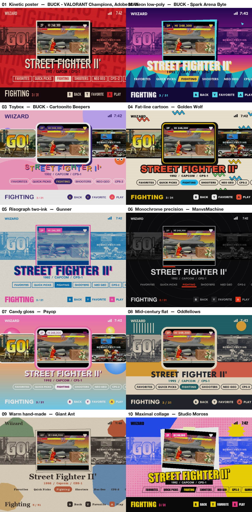

- `art/mockups/render20.py` and `render_short.py` draw the explorations and the shortlist (they need game stills,
  which aren't in the repo); the sheets and the candidate screens are in `art/mockups/`.
- `art/wizard-anim/anim.py` builds the intro from my PSD's layers (psd-tools): body, eyes, brows and sparkles as
  separate parts, puppeted; only the Wii Remote and the closed-eye lines are drawn new. `art/wizard-parts/` has the
  parts.
- `art/make_ui.py` pre-renders the static art with anti-aliasing (GX draws polygons without it) into `sdkit/ui/`:
  the paper, the attract band, and `wizard.wza`, the intro as zlib'd RGB5A3 frames the launcher streams one per frame.
- Fonts: Anton and Archivo Black (SIL OFL 1.1, licences in `sdkit/fonts/`). The installer also copies a few macOS
  system fonts onto the card from the Mac it runs on; those aren't redistributed here.
- Menu sounds are synthesised (`videos/sfx.py`): no samples to license.

## Building

The launcher and hop build with the `devkitpro/devkitppc` Docker image, so you don't need devkitPro installed:

```bash
./build.sh
```

That gives `agent/wii-agent.dol` and `hop/hop.dol`. `BUILD_HOST=user@box ./build.sh` builds on another machine with
Docker and copies the DOLs back. The Python tools need Python 3, numpy and Pillow (the art scripts also need
psd-tools; the media pipeline needs ffmpeg).

Nintendont and RetroArch need the 2019 toolchain (`devkitpro/devkitppc:20190212`); newer ones break Nintendont's
return to loader and clash with RetroArch's bundled Wii libraries. See their READMEs. Upstream sources:
[RetroArch](https://github.com/libretro/RetroArch) v1.22.2,
[fbalpha2012](https://github.com/libretro/fbalpha2012) (+ `_cps1`, `_cps2`, `_neogeo`),
[mame2000-libretro](https://github.com/libretro/mame2000-libretro),
[Genesis-Plus-GX](https://github.com/libretro/Genesis-Plus-GX),
[snes9x2010](https://github.com/libretro/snes9x2010),
[libretro-fceumm](https://github.com/libretro/libretro-fceumm),
[Nintendont](https://github.com/FIX94/Nintendont),
[USB Loader GX](https://sourceforge.net/projects/usbloadergx/),
[d2x cIOS](https://github.com/wiidev/d2x-cios),
[Priiloader](https://github.com/DacoTaco/priiloader),
[lwIP](https://savannah.nongnu.org/projects/lwip/),
[Dolphin](https://github.com/dolphin-emu/dolphin).

### Your own network

Nothing about a particular network is in the code. Copy `wiisite.example.json` to `wiisite.json` (git-ignored) or
set `WII_*` environment variables: the subnet the Wiis are on, the update server, the build/collector box, the NAS
holding your own game backups, and USB Loader GX's parental-lock password (`wiisite.py` lists them all).

## Setting up a cabinet

What a cabinet needs: an original Wii with the Homebrew Channel and Priiloader, a BootMii NAND backup, GameCube pads,
a CRT, and an SD card (128 GB, FAT32 with 32 KB clusters). cIOS is only needed for Wii discs.

1. **The card, on the Mac.** `sdkit_install.py /Volumes/WIISD [--games <list>]` checks the card (FAT32, cluster size,
   free space, that it's really the card), then installs the published launcher, Nintendont, USB Loader GX, RetroArch
   with its cores and config, media and metadata, and your own games. It only adds files; anything it replaces is
   kept next to it. Re-running it resumes and skips what's there.
2. **At the console, once (5-10 minutes).** Card in, Wi-Fi set up in the Wii Menu, start the launcher from the
   Homebrew Channel. That's the last time anyone needs a Wii Remote.
3. **Remotely.** `new_wii.py <ip> check` reports Priiloader, its boot file, AHBPROT and the TV settings;
   `new_wii.py <ip> apply --yes` backs up the four NAND files it may touch, tests hop from the card, then writes
   Priiloader's boot program, AHBPROT, autoboot, and 480i / 60 Hz / 4:3, reading each one back. A power cycle later
   the Wii boots straight into WIIZARD. Then calibrate the CRT with `screen`.

`NEW_WII.md` has the whole checklist, including what to do when something goes wrong.

## Simulator

`sim/mac_sim.sh start [dol] [--fast]`, `shot out.png`, `stop`: the launcher in a headless Dolphin built from source
with `sim/dolphin-wiisim.patch` (Metal on Apple silicon, full speed, agent on 127.0.0.1:4300, so the MCP tools work
against it). `sim/macsim.py` runs several slots side by side with frame and audio dumps; `sim/mac_atest.py` boots
games through the launcher and checks they started. Good for screens and boot tests, not for animation timing or
anything that needs a real System Menu.

## Licences

My code is MIT (`LICENSE`). Third-party pieces keep their own licences: see [`LICENSES.md`](LICENSES.md).

Built by Mitchell Vizensky with Claude.
